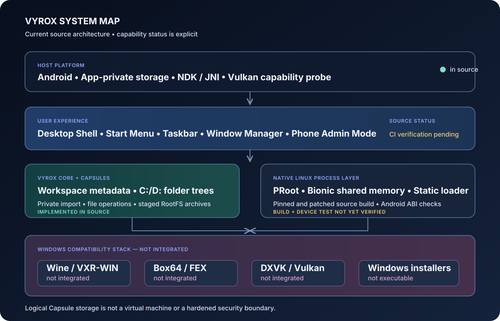

  

  
  
  
  

<strong>Your PC. Your Phone. Your Environment.</strong>

# VYROX

**VYROX is an open-source desktop-style runtime project hosted by Android.** It is designed to organize file-separated workspaces, manage imported Windows installers, and grow toward a tested Windows compatibility stack.

> **Important current limitation:** VYROX does not run Windows EXE/MSI programs yet. Installer import is only file import into private app storage; ZIP extraction writes files into a Capsule but does not install or execute a Windows program. Capsules are file-based workspaces, not virtual machines or hardened security sandboxes. Wine, CPU translation, and DirectX translation are not integrated.

## Visual architecture

  

## What is implemented in the source

| Area | Current implementation |
|---|---|
| Android application | Kotlin, Jetpack Compose, Android document picker |
| Desktop interface | Landscape-first shell, phone-admin orientation switch, Start menu, taskbar, multiple movable/resizable windows |
| Installer library | Imports EXE/MSI/ZIP files into private app storage; validates PE/COFF, MSI compound-file and ZIP directory headers; securely extracts ZIP files only inside a selected Capsule; does not execute them |
| Capsule workspaces | Create/list/delete/rename/clone app-private workspaces with independent C:/D: folder trees, portable ZIP backups, checksummed snapshots, restore and storage accounting |
| File manager | Browse, create, import, copy, move, rename, search, delete and safely extract ZIP archives within Capsule storage |
| Linux RootFS | Import and validate TAR/TAR.GZ/TAR.XZ images with staged extraction, path checks, size limits and SHA-256 metadata; does not execute them |
| Device detection | Android ABI, CPU count, memory, native architecture and Vulkan capability probes |
| Runtime planning | Engine catalog, Windows x64 prerequisite assessment, PRoot command planning, bounded process logs and a pinned Box64 0.4.4 source-build action inside an ARM64 glibc RootFS |
| Native build | Pinned Android PRoot source build, AArch64 ELF checks and APK packaging; Box64 has a separate in-RootFS source-build recipe (not an APK library) |

**Source implementation is not the same as verified runtime behavior.** The CI badge reports the latest GitHub Actions result. Native execution and Windows compatibility still require successful Android builds and physical-device testing.

Capsule backup and snapshot operations are file-level archives. They preserve the Capsule's current C:/D: data folders and metadata needed to identify a backup format; they do not capture a live process, running Windows registry, or VM memory image. Restoring a snapshot replaces the file-backed C:/D: trees after staging and validation.

## What is not implemented

- Wine or another Windows API compatibility layer.
- Running Windows EXE/MSI installers or launching Windows applications and games.
- Box64 built and executed on a physical Android device. The source includes a pinned v0.4.4 build action for an ARM64 Debian/Ubuntu RootFS, but that action and x86-64 execution are not yet device-verified. FEX is not integrated.
- DXVK, VKD3D-Proton, DirectX execution, or validated graphics translation.
- A working Windows registry and independent Wine Prefix for each Capsule.
- VM-grade isolation, malware scanning, or a hardened security sandbox.
- Verified PRoot ptrace and Linux RootFS execution on a physical Android device.
- Process, memory, temperature, GPU-frequency or CPU-frequency controls beyond what Android exposes to an ordinary app.

## Build requirements

- JDK 17
- Android SDK Platform 36 and Build Tools 36.0.0
- Android NDK 27.2.12479018
- CMake 3.22.1
- Gradle 8.13
- Android Gradle Plugin 8.13.2
- Kotlin 2.2.21

Run from the repository root after installing the Android SDK components:

~~~bash
gradle :runtime-engine:test :app:testDebugUnitTest :app:lintDebug :app:assembleDebug
~~~

The GitHub Actions workflow runs source-manifest checks, unit tests, the pinned ARM64 PRoot build, Android lint and debug APK assembly. When all required stages pass, the APK is uploaded as the vyrox-debug-apk artifact. Failed build output is retained in a diagnostic artifact where the corresponding stage runs.

## Project layout

~~~text
app/                 Android UI, storage and JNI bridge
runtime-engine/      Runtime catalog, RootFS, command planning and process supervision
scripts/             Reproducible native build and source validation helpers
third_party/         Pinned source and license metadata
docs/                Architecture and component documentation
.github/workflows/   Android CI
~~~

## Building Box64 inside a Capsule\n\nThe Runtime Manager includes a **Build Box64 0.4.4** action for an imported ARM64 Debian/Ubuntu RootFS. It fetches the immutable upstream v0.4.4 commit, builds with ARM64 DynaRec and PRoot mixed-kernel settings, and checks the installed AArch64 ELF plus version metadata. The action uses PRoot guest root identity only; it does not grant Android root. It binds only the required device nodes, `/proc`, and a temporary DNS configuration obtained from Android's active network. This is an x86-64 Linux translator, not a Windows PE loader. Physical-device build and x86-64 execution remain unverified. See [the Box64 build guide](docs/BOX64_RUNTIME_BUILD.md).\n\n## Component boundaries

- **PRoot** is a Linux filesystem/process redirection tool. It is not a Windows API layer, CPU translator, or security boundary.
- **Box64/FEX** target Linux x86/x86-64 userspace execution on ARM64 Linux; they do not load Windows PE files by themselves.
- **Wine** provides Windows API compatibility and must be built/configured for the selected Android/Linux userland.
- **DXVK/VKD3D-Proton** translate selected Direct3D interfaces over Vulkan; neither replaces Wine or a CPU translator.

Every native component must have a pinned upstream version, license notices, Android ABI build evidence, and device-test results before being declared integrated.

## Contribution and license

VYROX is licensed under [Apache-2.0](LICENSE). Before proposing or adding a runtime binary, document its upstream source, exact version, license, ABI, build method, and physical-device test results.
